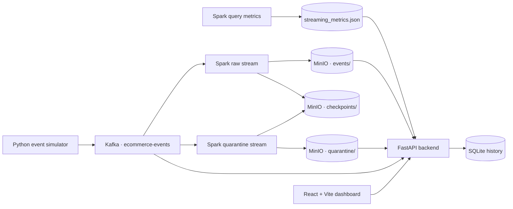

# FluxCart — DataOps & Streaming Infrastructure Platform

FluxCart is a real-time e-commerce event streaming and data-quality platform. It simulates customer journeys, publishes events to Apache Kafka, processes the stream with Apache Spark Structured Streaming, stores raw and rejected records as Parquet datasets in MinIO, and exposes pipeline and data-quality insights through a FastAPI backend and React dashboard.

> **Project focus:** Kafka-based event ingestion, Spark Structured Streaming, S3-compatible data-lake storage, quarantine handling, pipeline observability, and a full-stack monitoring dashboard.

## Architecture

The end-to-end system diagram and component responsibilities are documented in **[docs/architecture.md](docs/architecture.md)**.

At a glance:



## Key capabilities

- **Synthetic event generation:** creates multi-step e-commerce journeys with user, session, product, transaction, device, location, and timestamp fields.
- **Kafka ingestion:** publishes JSON events to the `ecommerce-events` topic, configured with three partitions in the local Compose stack.
- **Streaming processing:** Spark Structured Streaming runs separate raw-event and quarantine queries.
- **Data lake:** valid events and rejected records are written as Parquet to MinIO using the S3A connector.
- **Data quality:** validates event identifiers, event types, and timestamps; records rejected events with reason details.
- **Streaming observability:** exposes Spark query status, batch progress, input and processing rates, and offsets-behind-latest metrics.
- **Kafka monitoring:** backend endpoints retrieve topic and broker metadata and retained-message information.
- **Dashboard:** React pages cover Overview, Streaming, Data Lake, and Data Quality.
- **History:** sampled Spark batch metrics are retained in a local SQLite database.

## Technology stack

| Layer | Technologies |
|---|---|
| Event generation | Python 3.12, Faker, kafka-python |
| Message broker | Apache Kafka 4.0.1 |
| Stream processing | Apache Spark 4.0.0, PySpark Structured Streaming |
| Storage | MinIO, S3 API, Hadoop S3A, Parquet |
| Backend | FastAPI, Uvicorn, Boto3, PyArrow, SQLite |
| Frontend | React 19, Vite 8, Recharts, Lucide |
| Local infrastructure | Docker Compose |

## Data pipeline

1. The event simulator generates synthetic user journeys and publishes JSON events to Kafka.
2. Kafka stores the events in the `ecommerce-events` topic.
3. Spark consumes the topic and runs two streaming queries:
   - **Raw events:** parses the payload and keeps records with a non-null event ID, event type, and valid event timestamp.
   - **Quarantine:** identifies malformed JSON and records missing required fields or invalid timestamps, preserving the rejection reason and Kafka partition/offset metadata.
4. Spark writes valid Parquet records to `s3a://fluxcart-raw/events/` and rejected records to `s3a://fluxcart-raw/quarantine/`.
5. Each query uses its own checkpoint path under `s3a://fluxcart-raw/checkpoints/`.
6. Spark periodically writes query progress to `spark/data/streaming_metrics.json`.
7. FastAPI reads MinIO objects, Kafka metadata, and the Spark metrics file. When the streaming endpoint is polled, batch history is saved in SQLite.
8. The React dashboard calls the backend's `/api/*` endpoints and presents the current pipeline and data-quality views.

## Repository structure

```text
.
├── backend/
│   ├── app/
│   │   └── main.py
│   ├── requirements.txt
│   └── data/                 # Local SQLite history; ignored by Git
├── docs/
│   └── architecture.md
├── event-simulator/
│   ├── app/
│   │   ├── event_generator.py
│   │   ├── event_schema.json
│   │   ├── kafka_producer.py
│   │   └── main.py
│   ├── Dockerfile
│   └── requirements.txt
├── frontend/
│   ├── src/
│   ├── package.json
│   └── vite.config.js
├── infrastructure/
│   └── docker/
│       └── docker-compose.yml
├── spark/
│   ├── app/
│   │   └── main.py
│   ├── Dockerfile
│   └── requirements.txt
└── .gitignore
```

## Local setup

### Prerequisites

- Docker Desktop with Docker Compose
- Python 3.12 or a compatible Python version for the backend
- Node.js and npm compatible with the Vite version in `frontend/package.json`

### 1. Configure local MinIO credentials

The Compose file expects a root-level `.env.minio` file. Create it locally (do not commit it):

```dotenv
MINIO_ROOT_USER=your_local_minio_user
MINIO_ROOT_PASSWORD=replace_with_a_strong_local_password
```

The Spark container also mounts `spark/secrets/` as Hadoop configuration. Create `spark/secrets/core-site.xml` locally with the S3A endpoint `http://minio:9000`, the same MinIO access key and secret, path-style access enabled, and the Hadoop S3A filesystem implementation. Keep this file out of Git; the repository's `.gitignore` excludes `spark/secrets/`.

### 2. Start the streaming infrastructure

From the repository root:

```bash
docker compose -f infrastructure/docker/docker-compose.yml up -d --build
```

This Compose stack starts Kafka, creates the `ecommerce-events` topic, starts the event simulator and Spark, starts MinIO, and initializes the `fluxcart-raw` bucket.

Useful checks:

```bash
docker compose -f infrastructure/docker/docker-compose.yml ps
docker logs -f fluxcart-simulator
docker logs -f fluxcart-spark
```

### 3. Start the FastAPI backend

In a separate terminal, from the repository root:

```bash
python3 -m venv .venv
source .venv/bin/activate
pip install -r backend/requirements.txt
uvicorn backend.app.main:app --reload --host 0.0.0.0 --port 8000
```

The backend loads the root-level `.env.minio` file and reads the Spark metrics file from the project directory.

API documentation: [http://localhost:8000/docs](http://localhost:8000/docs)

### 4. Start the React dashboard

In another terminal:

```bash
cd frontend
npm install
npm run dev
```

Open [http://localhost:5173](http://localhost:5173).

## Backend API

| Endpoint | Purpose |
|---|---|
| `GET /` | API service information |
| `GET /api/health` | API and MinIO health |
| `GET /api/overview` | Raw, quarantine, and checkpoint object statistics |
| `GET /api/events` | Recent raw Parquet event records |
| `GET /api/quarantine` | Rejected records and rejection-reason counts |
| `GET /api/quality` | Sampled raw-event completeness checks |
| `GET /api/event-types` | Event-type counts from the raw sample |
| `GET /api/analytics` | Aggregated metrics from the raw event sample |
| `GET /api/pipeline` | API, MinIO, and dataset pipeline status |
| `GET /api/streaming` | Spark streaming query progress |
| `GET /api/streaming/history` | Stored streaming batch history |
| `GET /api/kafka` | Kafka topic and broker metrics |

Interactive API documentation is available at `/docs` while the backend is running.

## Configuration and generated data

The following are local runtime files and should not be committed:

- `.env.minio` — MinIO credentials used by Compose and the backend.
- `spark/secrets/core-site.xml` — Hadoop S3A configuration and credentials.
- `spark/data/` — Spark metrics output.
- `spark/checkpoints/` — local Spark checkpoint directory, if used.
- `backend/data/streaming_history.db` — local SQLite streaming history.
- Python virtual environments, Node modules, logs, and generated Parquet data.

A non-secret event simulator template is provided at [event-simulator/.env.example](event-simulator/.env.example).

## Metric interpretation and implementation notes

- The quality score is calculated from the raw records sampled by the API (up to 2,000 records); it is not a score over the complete lifetime event stream.
- One quarantined record can have multiple rejection reasons, so the sum of reason counts can exceed the number of rejected records.
- The quarantine query starts from Kafka's `latest` offsets and uses its own checkpoint. It is designed to capture newly arriving rejected events, not to replay the topic's full historical contents on first start.
- The Spark `offsets_behind_latest` value is a source-offset metric, not Kafka consumer-group lag.
- SQLite history is populated when `/api/streaming` is polled; it is not an independent background collector.
- In the current local-development setup, Docker Compose runs the streaming and storage services. FastAPI and the React/Vite frontend run separately on the host.

## Screenshots

Dashboard and pipeline screenshots will be added here as the project walkthrough is finalized.

## Future improvements

- Add automated backend and streaming integration tests.
- Add CI checks for linting, Python tests, and frontend production builds.
- Add dashboard screenshot assets and a concise demo walkthrough.
- Evaluate production deployment options, secret management, and service health monitoring.

---

**FluxCart** — Real-Time E-Commerce Intelligence & Streaming Data Platform.
