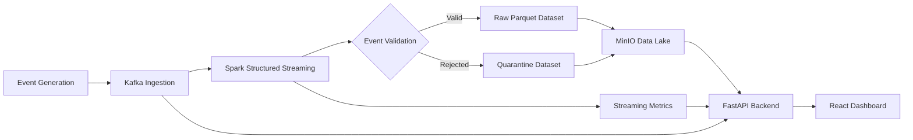
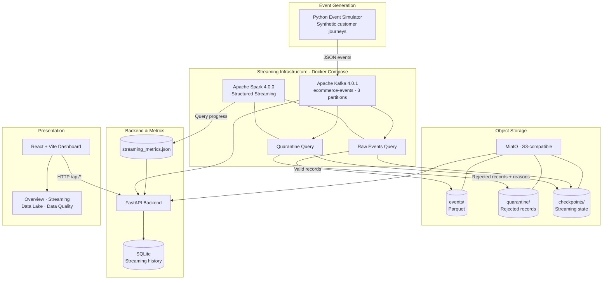
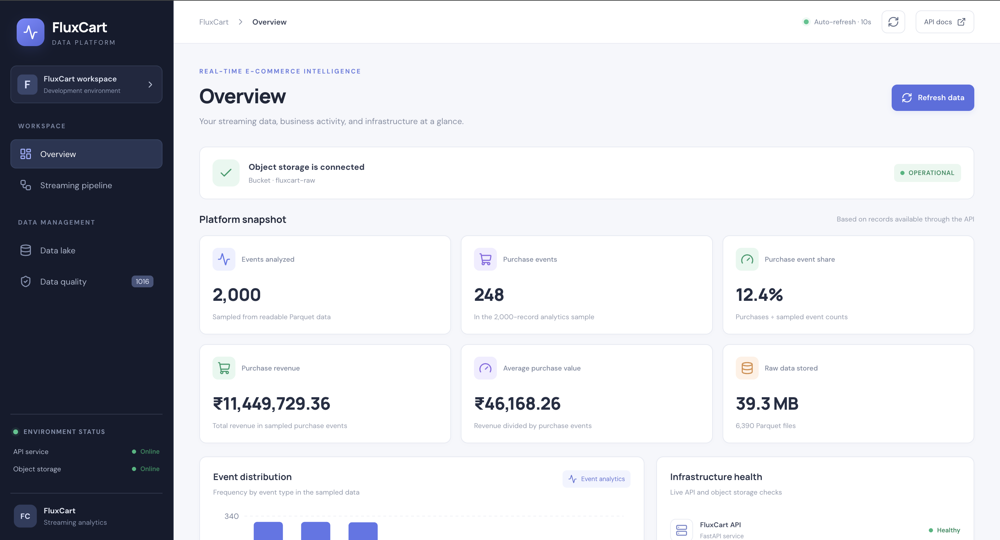
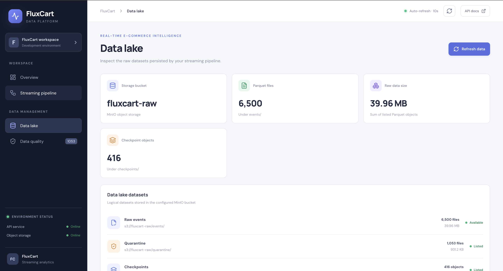
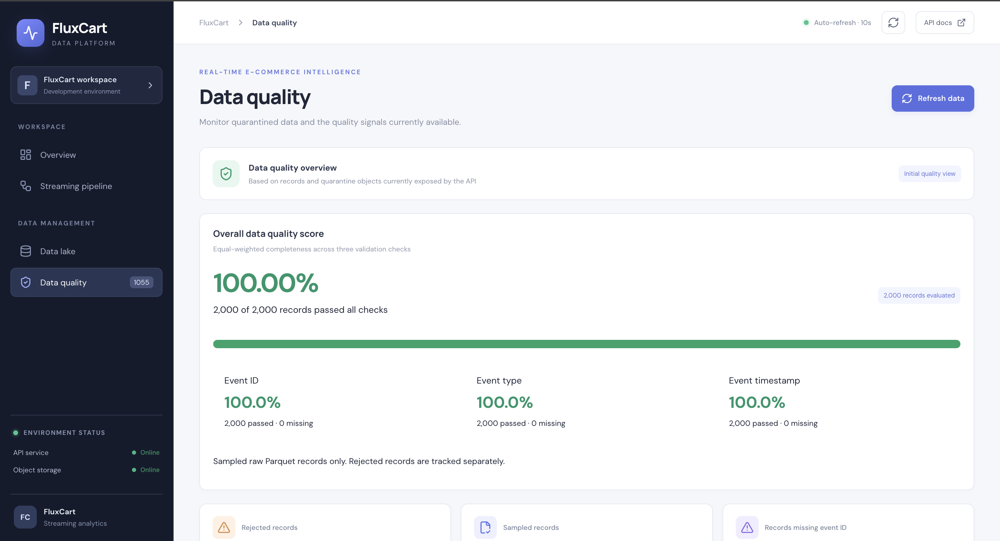

<div align="center">

# FluxCart — DataOps & Streaming Infrastructure Platform

### Real-Time E-Commerce Intelligence & Streaming Data Platform

**A full-stack data engineering platform that generates e-commerce events, streams them through Apache Kafka, processes and validates them with Spark Structured Streaming, and makes the resulting data and pipeline health observable through a live dashboard.**

[](#technology-stack)
[](#technology-stack)
[](#technology-stack)
[](#technology-stack)
[](#technology-stack)
[](#technology-stack)
[](#technology-stack)
[](#technology-stack)

</div>

---

## Overview

**FluxCart** is a real-time e-commerce event streaming and data-quality platform built to demonstrate an end-to-end data engineering workflow. It simulates customer journeys, publishes event data to Apache Kafka, processes the incoming stream using Apache Spark Structured Streaming, and persists valid and rejected records as Parquet datasets in MinIO object storage.

The platform includes a FastAPI backend and a React dashboard that bring together event activity, Kafka statistics, Spark processing metrics, data-lake information, and data-quality insights in one interface.

Rather than treating streaming, storage, and monitoring as separate demonstrations, FluxCart connects them into a single working pipeline — from event generation to processing, persistence, and operational visibility.

> **Implementation note:** In the current local-development setup, Docker Compose runs Kafka, the event simulator, Spark, and MinIO. The FastAPI backend and React/Vite dashboard run separately on the host. Spark progress is exposed to the backend through a shared metrics JSON file.

---

## Project Lifecycle

The following diagram summarizes the main stages of the FluxCart workflow.



---

## High-Level Architecture

FluxCart is organized into five logical layers: event generation, streaming infrastructure, object storage, application services, and dashboard presentation.



The detailed component responsibilities and runtime boundaries are documented in **[docs/architecture.md](docs/architecture.md)**.

---

## Key Features

| Category | Capabilities |
|---|---|
| **Synthetic Event Generation** | Generates multi-step e-commerce customer journeys and structured event payloads |
| **Kafka Ingestion** | Publishes JSON events to the `ecommerce-events` topic with three partitions |
| **Stream Processing** | Processes incoming Kafka events through Spark Structured Streaming |
| **Data Validation** | Checks event identifiers, event types, and event timestamps |
| **Quarantine Handling** | Separates malformed or invalid records and records rejection reasons |
| **Data Lake Storage** | Persists valid and rejected records as Parquet datasets in MinIO |
| **Checkpointing** | Maintains separate checkpoint locations for raw and quarantine queries |
| **Kafka Monitoring** | Exposes broker, topic, partition, offset, and retained-message information |
| **Streaming Observability** | Displays Spark query status, batch progress, input rates, and processing rates |
| **Historical Metrics** | Stores polled streaming batch history in SQLite |
| **Dashboard** | Presents overview, streaming, data-lake, and data-quality views |
| **API Documentation** | Provides interactive backend documentation through FastAPI Swagger UI |

---

## Technology Stack

| Layer | Technologies |
|---|---|
| **Event Generation** | Python 3.12, Faker, kafka-python |
| **Message Broker** | Apache Kafka 4.0.1 |
| **Stream Processing** | Apache Spark 4.0.0, PySpark Structured Streaming |
| **Storage Format** | Apache Parquet |
| **Object Storage** | MinIO, S3-compatible API |
| **Storage Connector** | Hadoop S3A |
| **Backend** | FastAPI, Python, Uvicorn |
| **Data Access** | Boto3, PyArrow |
| **History Store** | SQLite |
| **Frontend** | React 19, Vite 8 |
| **Visualization** | Recharts, Lucide |
| **Containerization** | Docker, Docker Compose |

---

## End-to-End Data Pipeline

### 1. Event Generation

The Python event simulator creates synthetic e-commerce customer journeys. Events represent customer interactions such as login, product search, product view, add-to-cart, checkout, payment, and purchase.

The simulator publishes JSON event messages to the Kafka topic:

```text
Topic: ecommerce-events
Partitions: 3
```

The event simulator supports configurable event-generation and anomaly rates through environment variables.

### 2. Kafka Ingestion

Apache Kafka acts as the event-ingestion and buffering layer between the simulator and Spark. The topic is configured with three partitions in the local Docker Compose environment.

### 3. Spark Structured Streaming

Spark consumes the Kafka topic and runs two independent streaming queries:

| Query | Responsibility | Output |
|---|---|---|
| **Raw Events** | Parses event payloads and retains records with a non-null event ID, event type, and valid timestamp | `s3a://fluxcart-raw/events/` |
| **Quarantine** | Detects malformed JSON and records with missing required fields or invalid timestamps | `s3a://fluxcart-raw/quarantine/` |

Each query uses its own checkpoint location under:

```text
s3a://fluxcart-raw/checkpoints/
```

The separate queries and checkpoints keep the valid-event path and rejected-event path independently managed.

### 4. Data Lake — MinIO & Parquet

MinIO provides S3-compatible object storage for the platform. Spark writes the processed records in Parquet format into the `fluxcart-raw` bucket.

| Prefix | Contents |
|---|---|
| `events/` | Validated raw event records |
| `quarantine/` | Rejected records with rejection reasons |
| `checkpoints/` | Spark streaming checkpoint state |

### 5. Metrics & Application Layer

Spark periodically writes query progress to:

```text
spark/data/streaming_metrics.json
```

The FastAPI backend reads this shared metrics file, retrieves Kafka metadata, and accesses MinIO objects and Parquet records. Streaming batch history is retained in a local SQLite database when the streaming endpoint is polled.

### 6. Dashboard Presentation

The React dashboard consumes the backend's `/api/*` endpoints and presents the platform's event activity, infrastructure information, streaming statistics, stored datasets, and data-quality results.

---

## Platform Walkthrough

The following screenshots are captured from the running FluxCart application. Each view is presented separately to keep dashboard details, metrics, and records readable.

### 1. Dashboard Overview

The Overview section provides a consolidated view of platform activity. It brings together high-level metrics, event activity, infrastructure information, and recent event records.

#### Platform Overview



* **FluxCart Dashboard Overview** — A centralized view of the platform's key metrics and current operational state.*

#### Event Analytics & Infrastructure


* **Event Analytics & Infrastructure Health** — Event activity presented alongside the health and availability of supporting platform services.*

#### Recent Event Records


* **Recent Event Records** — A closer look at the latest generated e-commerce events visible through the dashboard.*

---

### 2. Streaming Monitoring

The Streaming Monitoring section focuses on the runtime behavior of the data pipeline. It provides visibility into processing flow, infrastructure health, Kafka statistics, and throughput trends.

#### Data Processing Flow & Infrastructure Health


* **Streaming Pipeline & Infrastructure Health** — An operational view of the data-processing flow and the health of streaming components.*

#### Apache Kafka Monitoring


* **Apache Kafka Monitoring** — Kafka topic and partition information with key ingestion and retained-message statistics.*

#### Streaming Throughput & Historical Throughput


* **Streaming Throughput & Historical Trends** — Current streaming throughput presented alongside historical processing activity.*

---

### 3. Data Lake

The Data Lake view provides visibility into the datasets persisted by the streaming pipeline, including the MinIO-backed storage layer.



* **Data Lake Explorer** — A view of the platform's stored event datasets and object-storage information.*

---

### 4. Data Quality & Quarantine

The Data Quality view focuses on event validation and rejected records. It helps inspect the quality checks applied to incoming events and the records routed to quarantine.



* **Data Quality & Quarantine** — Monitoring event validation results and inspecting records isolated by the quarantine stream.*

---

### 5. Apache Spark Dashboard

The Spark dashboard provides an additional view into Spark application execution and streaming workload activity.


* **Apache Spark Dashboard** — Runtime visibility into Spark application execution, jobs, and processing activity.*

---

### 6. Backend API — Swagger UI

The FastAPI backend exposes the platform's functionality through REST endpoints. Swagger UI provides an interactive reference for exploring and testing the available API operations.


* **FastAPI Swagger UI** — Interactive API documentation for the FluxCart backend.*

---

## Backend API Reference

The backend exposes endpoints for health checks, data-lake information, event records, quality results, streaming metrics, and Kafka monitoring.

| Endpoint | Purpose |
|---|---|
| `GET /` | API service information and documentation path |
| `GET /api/health` | API and MinIO health information |
| `GET /api/overview` | Raw, quarantine, and checkpoint object statistics |
| `GET /api/events` | Recent event records read from raw Parquet data |
| `GET /api/event-types` | Event-type counts from the raw event sample |
| `GET /api/analytics` | Aggregated analytics from the raw event sample |
| `GET /api/quality` | Sampled raw-event completeness and quality checks |
| `GET /api/quarantine` | Rejected records and rejection-reason counts |
| `GET /api/pipeline` | API, MinIO, and dataset pipeline status |
| `GET /api/streaming` | Spark streaming query progress |
| `GET /api/streaming/history` | Stored streaming batch history |
| `GET /api/kafka` | Kafka broker, topic, partition, and offset metrics |

Interactive API documentation is available at:

`http://localhost:8000/docs`

---

## Engineering Details & Design Considerations

| Engineering Area | Implementation |
|---|---|
| **Independent stream paths** | Raw and quarantine processing run as separate Spark Structured Streaming queries |
| **Fault recovery state** | Each streaming query has its own checkpoint location |
| **Schema-aware parsing** | Spark parses JSON payloads against a defined event schema |
| **Data-quality isolation** | Invalid events are written separately with rejection reasons |
| **Columnar storage** | Processed datasets are stored in Parquet format |
| **S3-compatible access** | Spark uses Hadoop S3A to write to MinIO |
| **Metrics handoff** | Spark writes query progress to a JSON file shared with the host |
| **Historical monitoring** | The backend records polled streaming metrics in SQLite |

### Metric Interpretation Notes

- The data-quality score is calculated from the raw records sampled by the API (up to 2,000 records); it is not a score over the complete lifetime event stream.
- A quarantined record can contain multiple rejection reasons. Therefore, the sum of rejection-reason counts can exceed the number of rejected records.
- The quarantine query starts from Kafka's `latest` offsets in the current implementation. It is intended to capture newly arriving rejected events rather than replay the topic's complete historical contents on its first start.
- The Spark `offsets_behind_latest` value is a source-offset measure, not Kafka consumer-group lag.
- SQLite streaming history is collected when the `/api/streaming` endpoint is polled. It is not an independent background metrics collector.
- In the current local-development setup, Docker Compose runs the streaming and storage services, while FastAPI and React/Vite run separately on the host.

---

## Repository Structure

```text
FluxCart/
├── backend/
│   ├── app/
│   │   └── main.py
│   ├── requirements.txt
│   └── data/                         # Local SQLite history (Git-ignored)
├── docs/
│   ├── architecture.md
│   └── images/
│       ├── dashboard-overview/
│       ├── streaming-monitoring/
│       ├── data-lake/
│       ├── data-quality/
│       ├── spark/
│       └── api-documentation/
├── event-simulator/
│   ├── app/
│   │   ├── event_generator.py
│   │   ├── event_schema.json
│   │   ├── kafka_producer.py
│   │   └── main.py
│   ├── Dockerfile
│   ├── requirements.txt
│   └── .env.example
├── frontend/
│   ├── src/
│   ├── package.json
│   ├── package-lock.json
│   └── vite.config.js
├── infrastructure/
│   └── docker/
│       └── docker-compose.yml
├── spark/
│   ├── app/
│   │   └── main.py
│   ├── Dockerfile
│   └── requirements.txt
└── .gitignore
```

---

## Getting Started — Local Development

### Prerequisites

- Docker Desktop with Docker Compose
- Python 3.12 or a compatible Python version for the backend
- Node.js and npm compatible with the Vite version in `frontend/package.json`

### 1. Clone the Repository

```bash
git clone https://github.com/sahilsingh12221802/FluxCart-DataOps-And-Streaming-Infrastructure-Platform.git
cd FluxCart-DataOps-And-Streaming-Infrastructure-Platform
```

### 2. Configure MinIO Credentials

Create a root-level `.env.minio` file locally. Do not commit this file.

```dotenv
MINIO_ROOT_USER=your_local_minio_user
MINIO_ROOT_PASSWORD=replace_with_a_strong_local_password
```

The Spark container also requires `spark/secrets/core-site.xml` for Hadoop S3A configuration. Configure the S3A endpoint as `http://minio:9000`, use the same local MinIO credentials, enable path-style access, and configure the Hadoop S3A filesystem implementation.

Keep credential-bearing configuration files out of Git.

### 3. Start the Streaming Infrastructure

From the repository root:

```bash
docker compose -f infrastructure/docker/docker-compose.yml up -d --build
```

The Compose stack starts:

- Apache Kafka and topic initialization
- The Python event simulator
- Apache Spark Structured Streaming
- MinIO object storage
- MinIO bucket initialization

Check the running services and logs:

```bash
docker compose -f infrastructure/docker/docker-compose.yml ps
docker logs -f fluxcart-simulator
docker logs -f fluxcart-spark
```

### 4. Start the FastAPI Backend

Open a separate terminal at the repository root:

```bash
python3 -m venv .venv
source .venv/bin/activate
pip install -r backend/requirements.txt
uvicorn backend.app.main:app --reload --host 0.0.0.0 --port 8000
```

The backend reads the local MinIO environment configuration and the Spark metrics file from the project directory.

- API base: `http://localhost:8000`
- Swagger UI: `http://localhost:8000/docs`

### 5. Start the React Dashboard

Open another terminal:

```bash
cd frontend
npm install
npm run dev
```

Open the dashboard at:

`http://localhost:5173`

---

## Configuration & Runtime Files

The following files and directories are local runtime assets and should not be committed:

| File / Directory | Purpose |
|---|---|
| `.env.minio` | Local MinIO credentials |
| `.env.spark.minio` | Local Spark/MinIO environment configuration, if used |
| `spark/secrets/core-site.xml` | Hadoop S3A configuration and credentials |
| `spark/data/` | Spark metrics output |
| `spark/checkpoints/` | Local Spark checkpoint data, if used |
| `backend/data/streaming_history.db` | Local SQLite streaming history |
| `*.parquet` | Generated Parquet data |
| `.venv/`, `node_modules/` | Local development dependencies |

A non-secret simulator environment template is provided at `event-simulator/.env.example`.

---

## Engineering Challenges & Solutions

| Engineering Consideration | Approach |
|---|---|
| **Separating valid and invalid events** | Implemented independent raw and quarantine streaming queries |
| **Preserving streaming state** | Configured separate checkpoint locations for each query |
| **Storing streaming output** | Used Parquet datasets in MinIO through Hadoop S3A |
| **Making Spark metrics available to the backend** | Wrote query progress to a shared JSON metrics file |
| **Presenting streaming history** | Persisted polled batch metrics in SQLite |
| **Interpreting monitoring values correctly** | Documented the difference between source offsets, consumer-group lag, sampled quality, and rejection-reason counts |

---

## Engineering Capabilities Demonstrated

<div align="center">
<table>
<tr>
<td valign="top" width="25%">

**Data Engineering**
- Event generation
- Kafka ingestion
- Stream processing
- Schema-aware parsing

</td>
<td valign="top" width="25%">

**Data Quality**
- Required-field validation
- Timestamp validation
- Malformed-event handling
- Quarantine processing

</td>
<td valign="top" width="25%">

**Data Infrastructure**
- Docker Compose
- MinIO object storage
- S3A integration
- Parquet datasets

</td>
<td valign="top" width="25%">

**Application & Observability**
- FastAPI services
- React dashboard
- Kafka monitoring
- Spark metrics and history

</td>
</tr>
</table>
</div>

---

<div align="center">

### Built as an end-to-end real-time data engineering platform

*Event Generation → Kafka → Spark Structured Streaming → Data Lake → FastAPI → React Dashboard*

**FluxCart — Turning streaming events into observable data.**

</div>
