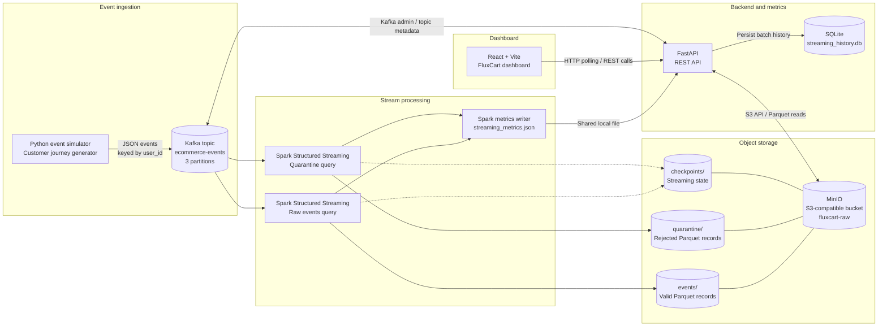

# FluxCart Architecture

FluxCart is a real-time e-commerce event streaming and analytics platform. It generates simulated customer journeys, transports events through Apache Kafka, processes them with Spark Structured Streaming, stores valid and rejected records in MinIO, and exposes operational and data-quality views through a FastAPI service and React dashboard.

## System architecture

## Component responsibilities

| Component | Responsibility |
|---|---|
| Python event simulator | Generates synthetic e-commerce customer journeys and publishes JSON events to Kafka. |
| Apache Kafka | Buffers and distributes events on the `ecommerce-events` topic, configured with three partitions. |
| Spark Structured Streaming | Reads Kafka events, parses the event schema, writes valid records to the raw dataset, and routes validation failures to quarantine. |
| MinIO | Provides S3-compatible object storage for raw Parquet data, quarantine data, and streaming checkpoints. |
| Spark metrics writer | Periodically writes the latest streaming-query progress to `spark/data/streaming_metrics.json`. |
| FastAPI | Serves health, pipeline, event, analytics, quality, quarantine, Kafka, and Spark streaming endpoints. |
| SQLite | Stores the Spark streaming batch history collected by the API. |
| React + Vite | Presents the overview, streaming, data lake, and data quality dashboard pages. |

## Event processing flow

1. The simulator creates customer journeys containing events such as `USER_LOGIN`, `PRODUCT_SEARCH`, `PRODUCT_VIEW`, `ADD_TO_CART`, `CHECKOUT`, `PAYMENT`, and `PURCHASE`.
2. The Kafka producer serializes each event as JSON and publishes it to `ecommerce-events`, using the user ID as the message key.
3. Spark reads the Kafka topic and extracts event, user, product, transaction, context, timestamp, and Kafka metadata fields.
4. The raw query writes records that contain an event ID, event type, and valid event timestamp to the `events/` prefix in MinIO as Parquet.
5. A separate quarantine query evaluates newly arriving records and writes malformed or invalid events with rejection reasons to `quarantine/`.
6. Both streaming queries maintain their own checkpoint locations under `checkpoints/` in MinIO.
7. Spark periodically writes query progress metrics to a JSON file. The FastAPI service reads that file, stores batch history in SQLite, and exposes the current metrics to the dashboard.
8. FastAPI reads Parquet data and object metadata from MinIO and queries Kafka metadata for the dashboard. The React frontend consumes these API endpoints.

## Storage layout

The MinIO bucket is configured as `fluxcart-raw`.

| Prefix | Contents |
|---|---|
| `events/` | Validated raw event records in Parquet format. |
| `quarantine/` | Rejected records with validation reasons and Kafka metadata. |
| `checkpoints/` | Spark Structured Streaming checkpoint data for the raw and quarantine queries. |

## Runtime topology

Docker Compose manages Kafka, Kafka topic initialization, the event simulator, Spark, MinIO, and MinIO bucket initialization.

The FastAPI backend and React/Vite frontend are run separately in the local development environment. The backend reads the Spark metrics JSON file from the project directory; this file is generated by the Spark container through the configured host volume mount.

## Important implementation notes

- The Kafka topic is configured with three partitions and replication factor one in the local single-broker setup.
- The raw Spark query uses the configured `KAFKA_STARTING_OFFSETS` value (set to `earliest` in the Compose configuration).
- The quarantine query uses a separate Kafka source and checkpoint and is configured to start at `latest`. It therefore handles events arriving after that query starts rather than backfilling the topic's earlier history.
- The dashboard's quality score describes the sampled raw Parquet records evaluated by the API; rejected records are reported separately.
- The streaming history is stored locally in SQLite. It is populated when the API reads current streaming metrics.
- The Kafka offset metric shown by the streaming API is Spark's source offset distance from the latest Kafka offset; it should not be interpreted as consumer-group lag.

## Technology stack

- **Ingestion:** Python, kafka-python
- **Event streaming:** Apache Kafka 4.0.1
- **Stream processing:** Apache Spark Structured Streaming 4.0.0, PySpark
- **Object storage:** MinIO, S3 API, Parquet
- **Backend:** FastAPI, Boto3, PyArrow, SQLite
- **Frontend:** React, Vite, Recharts, Lucide React
- **Local orchestration:** Docker Compose
