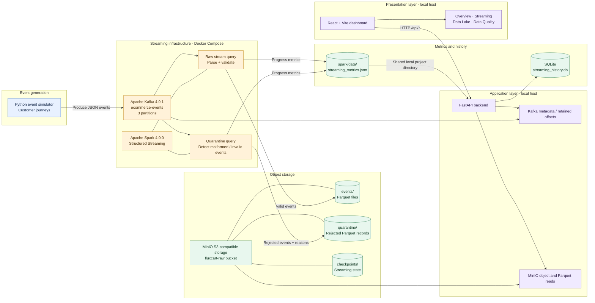

# FluxCart Architecture

FluxCart is a real-time e-commerce event streaming and data-quality platform. It generates synthetic customer journeys, streams events through Kafka, processes them with Spark Structured Streaming, stores Parquet datasets in MinIO, and exposes operational and data-quality views through a FastAPI service and React dashboard.

## End-to-end architecture

## Component responsibilities

| Component | Responsibility |
|---|---|
| Python event simulator | Generates synthetic e-commerce customer journeys and publishes JSON events to Kafka. |
| Apache Kafka | Buffers the `ecommerce-events` stream across three partitions. |
| Apache Spark Structured Streaming | Runs independent raw-event and quarantine streaming queries. |
| Raw stream | Parses event payloads and writes records with an event ID, event type, and valid event timestamp to Parquet. |
| Quarantine stream | Captures malformed payloads and records missing required fields or invalid timestamps with rejection reasons. |
| MinIO | Provides S3-compatible object storage for raw Parquet data, quarantine data, and Spark checkpoints. |
| Spark metrics writer | Periodically writes query progress to `spark/data/streaming_metrics.json`. |
| FastAPI | Exposes health, pipeline, Kafka, streaming, event, analytics, and data-quality endpoints. |
| SQLite | Retains sampled Spark streaming history collected when the streaming metrics endpoint is polled. |
| React + Vite | Presents the operational dashboard and data-quality views. |

## Data flow

1. The simulator creates synthetic user journeys, including login, search, product view, cart, checkout, payment, and purchase events.
2. Events are published to Kafka topic `ecommerce-events`.
3. Spark reads Kafka and runs two streaming queries:
   - **Raw query:** parses events, validates required fields, and writes valid records to `s3a://fluxcart-raw/events/`.
   - **Quarantine query:** evaluates malformed JSON and required-field/timestamp failures, then writes rejected records and rejection reasons to `s3a://fluxcart-raw/quarantine/`.
4. Both queries use separate checkpoint locations under `s3a://fluxcart-raw/checkpoints/`.
5. Spark writes query progress to a local metrics JSON file. The backend reads this file and stores polled batch history in SQLite.
6. FastAPI reads object metadata and Parquet data from MinIO and obtains Kafka metadata for monitoring.
7. The React dashboard calls the FastAPI `/api/*` endpoints to display pipeline status, streaming metrics, raw events, storage, analytics, and quarantine results.

## Runtime boundaries

The current Docker Compose stack contains Kafka, topic initialization, the event simulator, Spark, MinIO, and MinIO bucket initialization. The FastAPI backend and React/Vite frontend are run separately on the host during local development.

The Spark metrics file is shared with the host through the Compose volume mapping for `spark/data`. The backend reads that file from the project directory; it is not a direct Spark REST API integration.

## Important interpretation notes

- The raw and quarantine outputs are separate streaming queries with separate checkpoints.
- The quarantine query starts from Kafka's `latest` offsets in the current implementation; it is intended to capture newly arriving rejected events rather than replay the entire topic history on first start.
- The dashboard's data-quality score describes the sampled raw records checked by the API, not every event ever produced.
- The backend's SQLite history is collected as the streaming metrics endpoint is polled. It is not an independent background metrics collector.
- The displayed Spark source offset metric is an offsets-behind-latest measure, not Kafka consumer-group lag.
